<p align="center">
  <picture>
    <source media="(prefers-color-scheme: dark)" srcset="docs/assets/banner-dark.svg">
    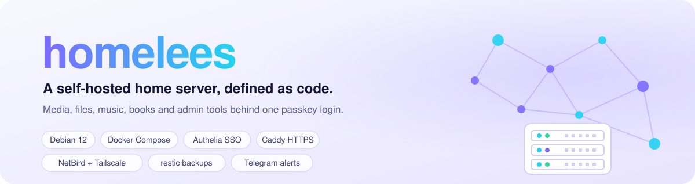
  </picture>
</p>

<p align="center">
  
  
  
  
  
  
</p>

<p align="center">
  <b><a href="#-services">Services</a></b> ·
  <b><a href="#-how-it-fits-together">Architecture</a></b> ·
  <b><a href="#-everyday-commands">Commands</a></b> ·
  <b><a href="#-documentation">Docs</a></b>
</p>

---

Every app on **homelees** is a Docker Compose stack in this repo: one folder per app,
pinned image versions, secrets kept in local `.env` files that never reach git.
`docker compose` is the main interface and **[Komodo](docs/services/komodo.md)** is the web UI over the same files.
Everything is reachable only from home or over the VPN. Nothing is exposed to the internet.

## ✨ Services

> 🔐 single sign-on (Authelia) · 🔑 SSO + the app's own login · 👤 app login only (native clients)

<table>
<tr><th colspan="4" align="left">🎬 Media & music</th></tr>
<tr>
<td align="center" width="25%">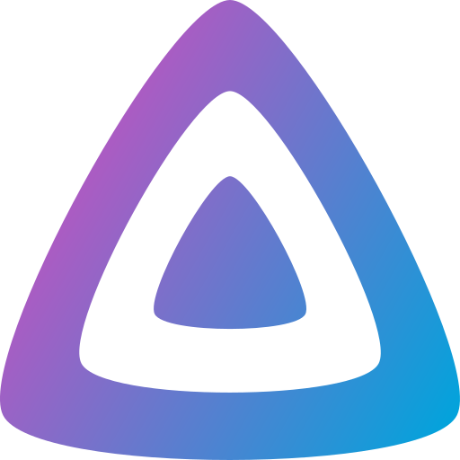<br><b><a href="docs/services/jellyfin.md">Jellyfin</a></b><br><sub>Movies, TV, music · 👤</sub></td>
<td align="center" width="25%">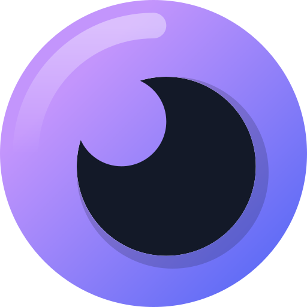<br><b><a href="docs/services/requests.md">Seerr</a></b><br><sub>Request movies & shows · 👤</sub></td>
<td align="center" width="25%">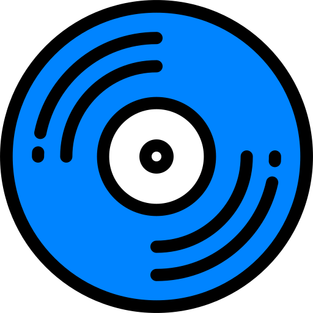<br><b><a href="docs/services/music.md">Navidrome</a></b><br><sub>Music streaming · 🔐</sub></td>
<td align="center" width="25%"><br><b><a href="docs/services/music.md#octo-fiesta">Octo-Fiesta</a></b><br><sub>Subsonic proxy, fills gaps · 👤</sub></td>
</tr>
<tr><th colspan="4" align="left">📁 Files, photos & books</th></tr>
<tr>
<td align="center"><br><b><a href="docs/services/nextcloud.md">Nextcloud</a></b><br><sub>Files, calendar, contacts · 🔐</sub></td>
<td align="center"><br><b><a href="docs/services/nextcloud.md#photos-memories">Memories</a></b><br><sub>Photo timeline · 🔐</sub></td>
<td align="center"><br><b><a href="docs/services/books.md">Calibre-Web</a></b><br><sub>Ebooks, OPDS, KOReader · 🔐</sub></td>
<td align="center"><br><b><a href="docs/services/books.md">Shelfmark</a></b><br><sub>Book finder · 🔑</sub></td>
</tr>
<tr><th colspan="4" align="left">⬇️ Downloads (behind the Gluetun VPN)</th></tr>
<tr>
<td align="center">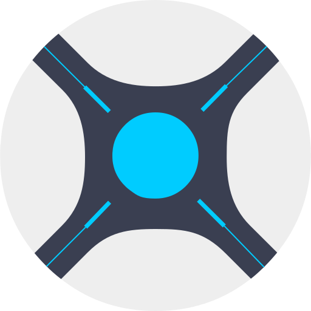 <br><b><a href="docs/services/downloads.md">Sonarr · Radarr</a></b><br><sub>TV & movies · 🔐</sub></td>
<td align="center">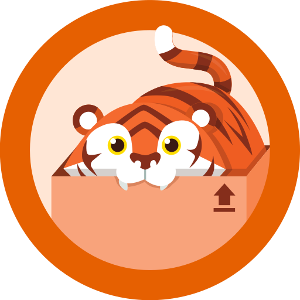 <br><b><a href="docs/services/downloads.md">Prowlarr · Bazarr</a></b><br><sub>Indexers & subtitles · 🔐</sub></td>
<td align="center">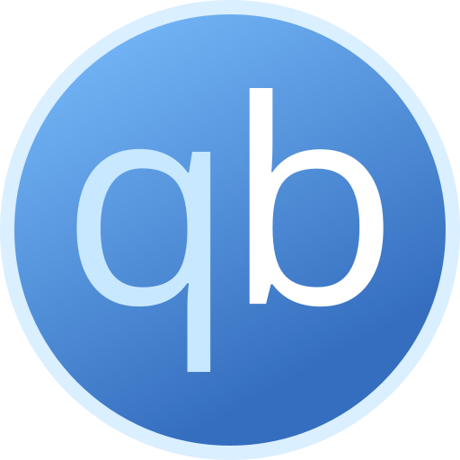 <br><b><a href="docs/services/downloads.md">qBittorrent · SABnzbd</a></b><br><sub>Download clients · 🔐</sub></td>
<td align="center">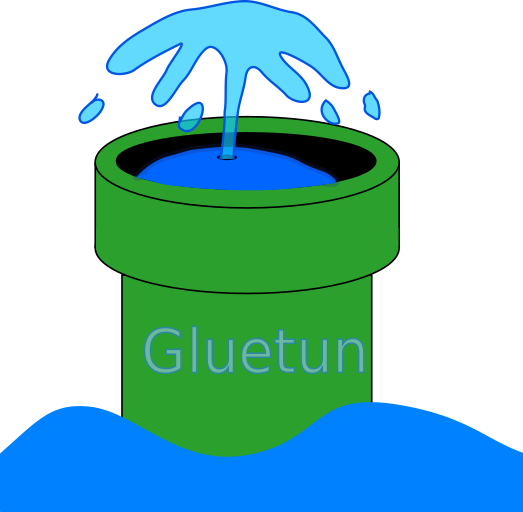<br><b><a href="docs/services/downloads.md#vpn-gluetun--required">Gluetun</a></b><br><sub>VPN kill-switch</sub></td>
</tr>
<tr><th colspan="4" align="left">🛠️ Admin & monitoring</th></tr>
<tr>
<td align="center"><br><b><a href="docs/services/homepage.md">Homepage</a></b><br><sub>Start page for everything · 🔐</sub></td>
<td align="center"><br><b><a href="docs/services/komodo.md">Komodo</a></b><br><sub>Manage the stacks · 🔐</sub></td>
<td align="center">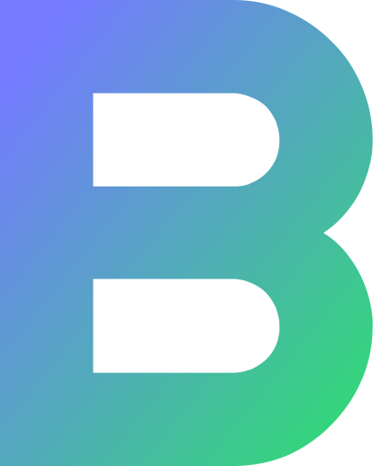<br><b><a href="docs/services/beszel.md">Beszel</a></b><br><sub>Host & container metrics · 🔐</sub></td>
<td align="center"><br><b><a href="docs/services/cockpit.md">Cockpit</a></b><br><sub>Host admin · 🔑</sub></td>
</tr>
<tr><th colspan="4" align="left">🧱 Platform</th></tr>
<tr>
<td align="center"> <br><b><a href="docs/access.md#sso--https-optstackssso--httpsservicehomeleesparty">Caddy · Authelia</a></b><br><sub>HTTPS + passkey SSO</sub></td>
<td align="center"> <br><b><a href="docs/access.md">NetBird · Tailscale</a></b><br><sub>Private remote access</sub></td>
<td align="center">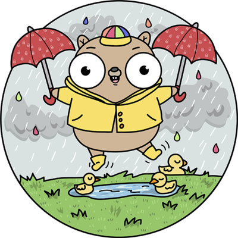<br><b><a href="docs/monitoring.md#backups-restic">restic</a></b><br><sub>Nightly backups</sub></td>
<td align="center"> <br><b><a href="docs/monitoring.md#telegram-bot-optstackstelegram-bot">Telegram bot</a> · <a href="docs/services/ferdium.md">Ferdium</a></b><br><sub>Alerts · app sync 👤</sub></td>
</tr>
</table>

## 🗺️ How it fits together

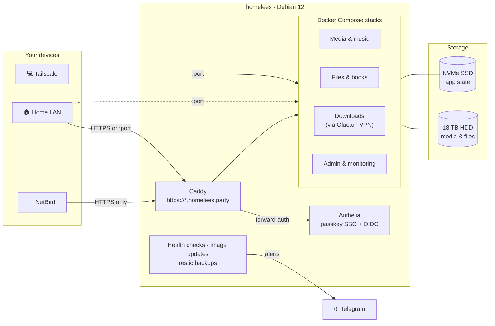

- **One login.** `https://<app>.homelees.party` goes through Caddy and Authelia (passkey or password + 2FA). Nextcloud, Komodo and Beszel use Authelia as their OIDC login. → [Remote access & SSO](docs/access.md)
- **Private by design.** The DNS record points to a private NetBird IP. Over NetBird only HTTPS is open, so the SSO can't be bypassed. No router ports are forwarded.
- **Fast state, big media.** App databases live on the NVMe (`/home/<app>`). Media, downloads and Nextcloud files live on the 18 TB disk (`/mnt/media`). → [Storage](docs/storage.md)
- **Watched.** A health check runs every 10 minutes, with a daily report, new-image alerts and backup status sent to Telegram. → [Monitoring](docs/monitoring.md)

## ⚡ Everyday commands

```bash
cd /opt/stacks/<app>
sudo docker compose up -d            # start / apply changes
sudo docker compose logs -f          # follow logs
sudo docker compose pull && sudo docker compose up -d   # update after bumping the tag

cd /opt/stacks && git add -A && git commit -m "…" && git push   # gitleaks pre-commit hook blocks secrets
```

Docker always needs `sudo`; the admin user is deliberately not in the `docker` group. More in the [operations runbook](docs/operations.md).

## 📚 Documentation

| | Guide | What's inside |
| :-: | :--- | :--- |
| 🧭 | [Operations runbook](docs/operations.md) | layout, permissions, daily ops, logs, updates, rollback, git |
| 🔐 | [Remote access & SSO](docs/access.md) | Tailscale, NetBird, Caddy, Authelia, OIDC apps |
| 🛡️ | [Host security](docs/security.md) | SSH, firewall (nftables), unattended upgrades |
| 📈 | [Monitoring, alerts & backups](docs/monitoring.md) | health check, image updates, Telegram bot, restic |
| 💾 | [Storage](docs/storage.md) | the 18 TB media disk and its folders |
| 🗃️ | [Retired services & archive](docs/history.md) | what was removed and where its data went |

**Per service:** [Homepage](docs/services/homepage.md) · [Komodo](docs/services/komodo.md) · [Cockpit](docs/services/cockpit.md) · [Jellyfin](docs/services/jellyfin.md) · [Downloads](docs/services/downloads.md) · [Seerr](docs/services/requests.md) · [Nextcloud](docs/services/nextcloud.md) · [Beszel](docs/services/beszel.md) · [Ferdium](docs/services/ferdium.md) · [Music](docs/services/music.md) · [Books](docs/services/books.md)

## 📂 Repository layout

```text
/opt/stacks
├── <app>/compose.yaml     one stack per folder (+ .env.example; real .env is local only)
├── host/                  host config tracked in git: ports.txt, systemd units, scripts,
│                          image-watch.yml (daily image-update check), site-env.sh
├── site.env.example       site values (LAN IP, domain, VPN names); real site.env is local only
├── docs/                  everything that used to be in this README
└── README.md              you are here
```

Stacks: `beszel` `books` `downloads` `ferdium` `homepage` `jellyfin` `komodo` `navidrome` `nextcloud` `octo-fiesta` `requests` `sso` `telegram-bot`

<sub>Icons from <a href="https://github.com/homarr-labs/dashboard-icons">dashboard-icons</a> and each project's own artwork; trademarks belong to their owners.</sub>
